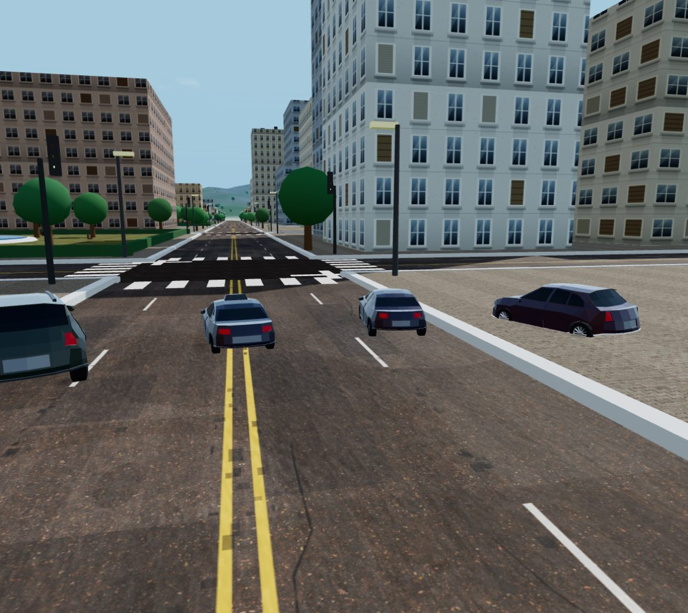
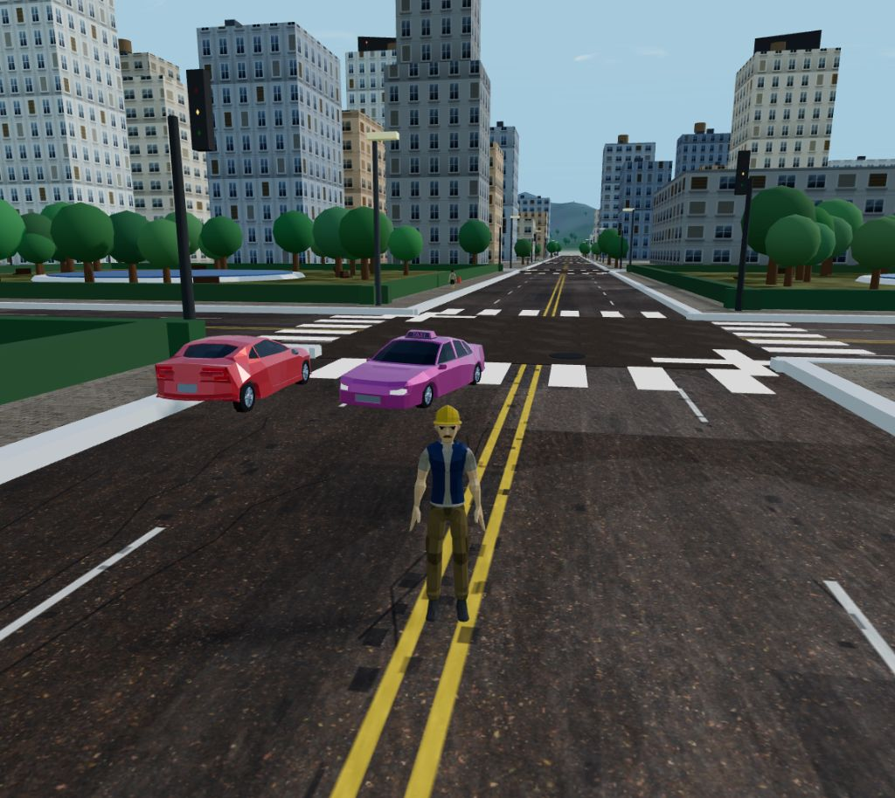
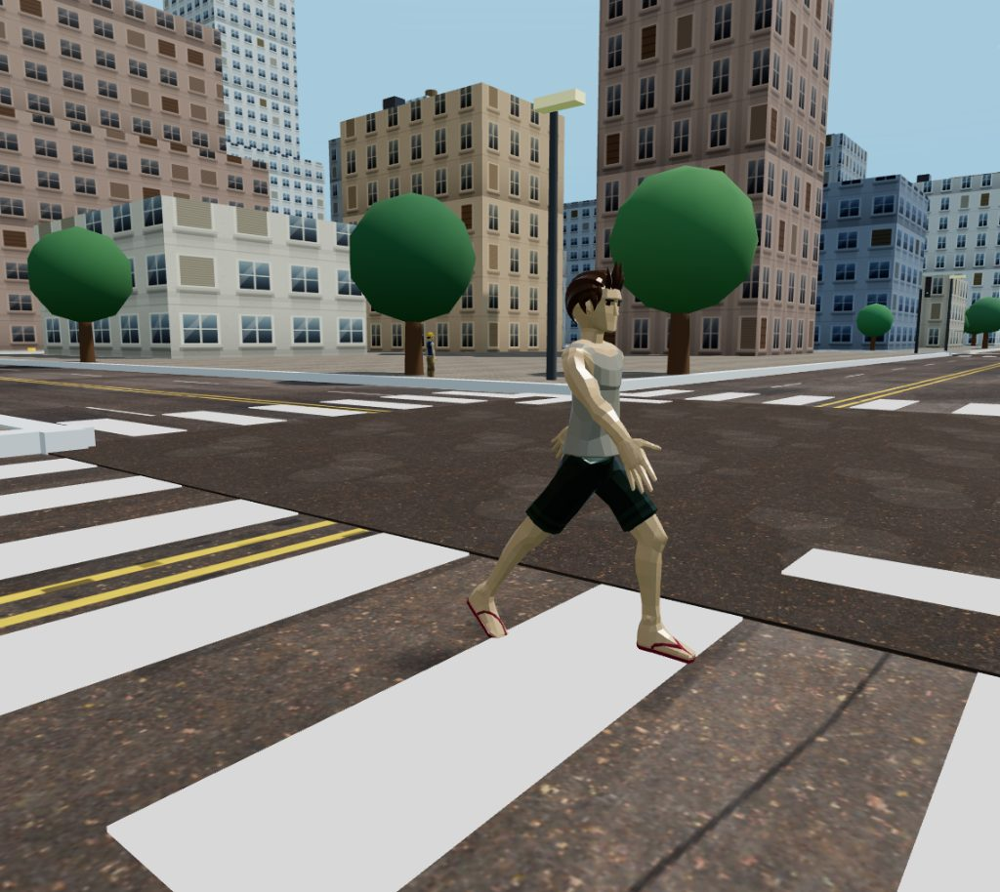
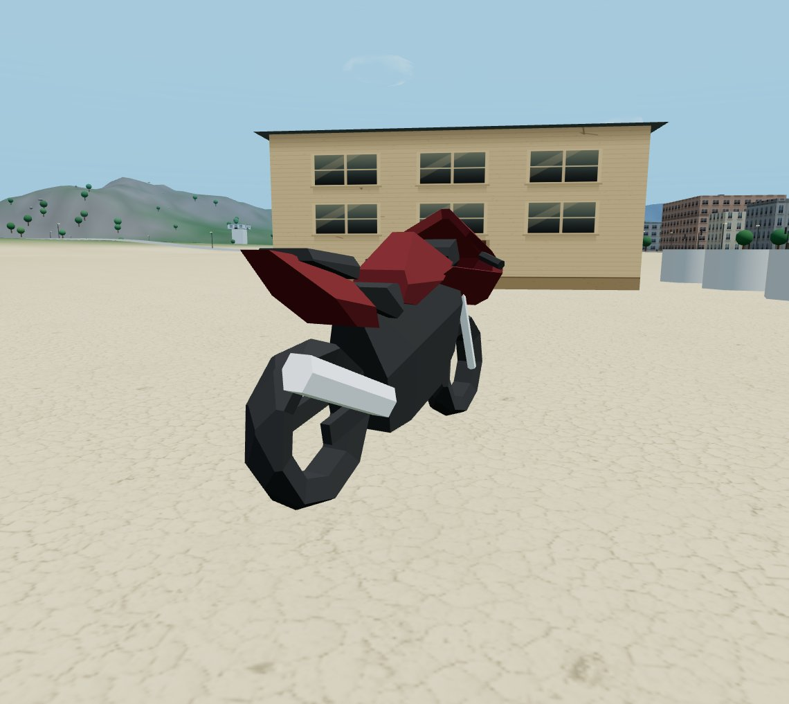
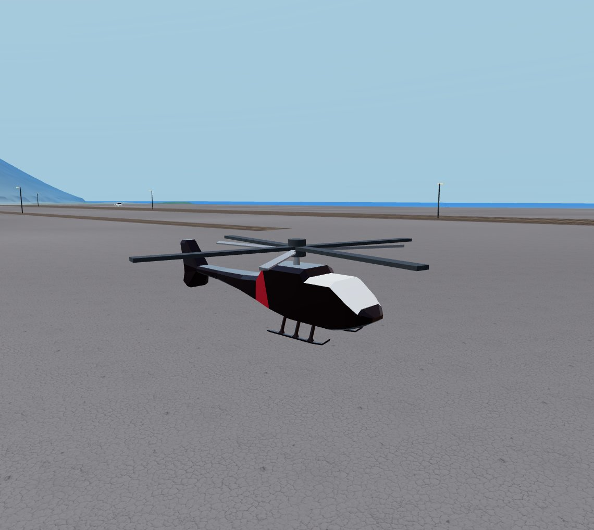
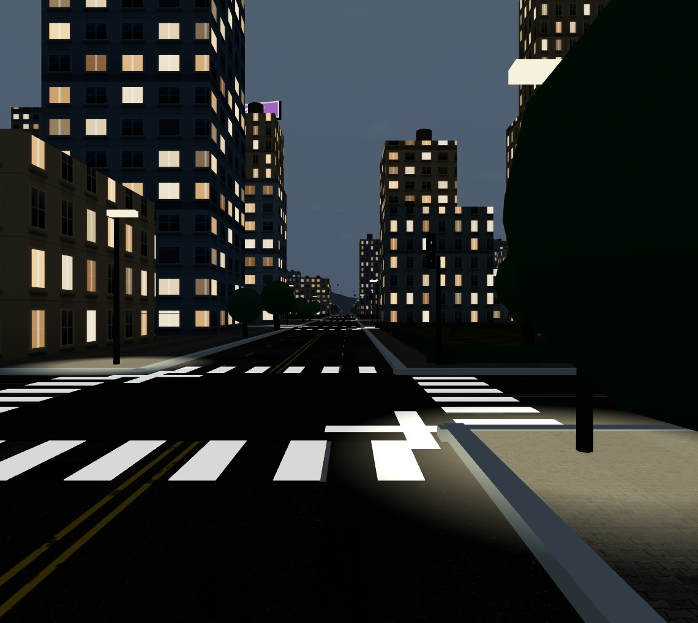
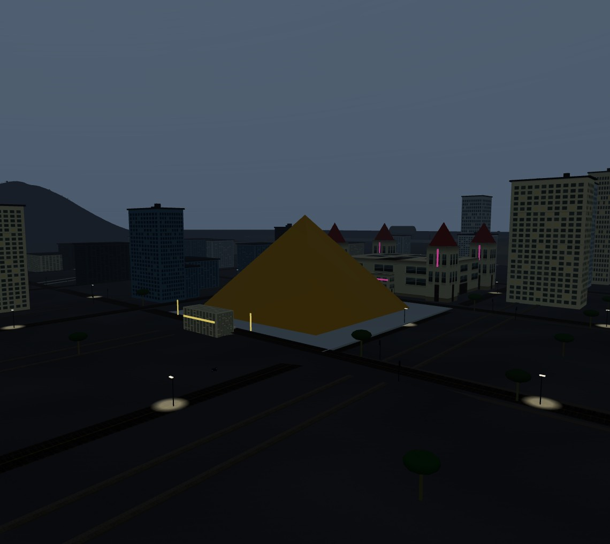
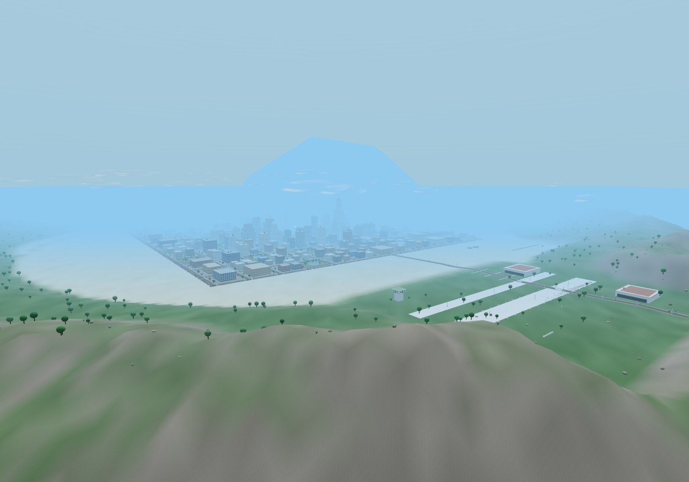

# Open World 3D — Enhanced Edition

[](LICENSE)
[](CREDITS.md)
[](https://threejs.org)
[](#why-is-it-one-big-html-file)
[](CONTRIBUTING.md)

> **A GTA-style open-world sandbox that runs in one HTML file.**
> Procedurally built island city · real 3D models · traffic and pedestrians · gangs · six-star
> police chases · missions · casino gambling · radio · day/night and weather · save system —
> powered by [three.js](https://threejs.org) with **zero external game assets**: every model and
> texture is embedded in the file and is free to use (CC0 / CC-BY, see [CREDITS.md](CREDITS.md)).



**▶ Play it now:** download [`index1.html`](index1.html) and open it in a browser. That's it — that
single file *is* the whole game (~16 MB).

---

## 💬 Help wanted — contributors & coordination needed!

This started as a solo hobby project and it has outgrown its maintainer. It is playable, stable
and fully open source, but to become a **polished production-quality open-source game** it needs
more hands:

* 🚗 **3D artists / model swaps** — replace or add vehicles, characters, animations
* ⚡ **Performance engineers** — draw calls, instancing, LOD, mobile support
* 🎮 **Gameplay devs** — missions, interiors, activities, AI, weapons
* 🧪 **Testers** — cross-browser QA, bug hunting, balancing
* 📝 **Writers** — docs, tutorials, issue triage, translation

**No contribution is too small** — a typo fix, a bug report, or a screenshot of a glitch all help.
See [Help wanted — contributors & coordination](#help-wanted--contributors--coordination) and
[CONTRIBUTING.md](CONTRIBUTING.md) for how to get involved. **Coordination happens in GitHub
[Issues](../../issues) and [Discussions](../../discussions)** — please open an issue before large
changes so we can agree on a direction first.

---

## Table of contents

* [Features](#features)
* [Screenshots](#screenshots)
* [Playing locally](#playing-locally)
* [Controls](#controls)
* [Cheat codes](#cheat-codes)
* [Save system](#save-system)
* [Repository layout](#repository-layout)
* [Building from source](#building-from-source)
* [Modding (replacing models & textures)](#modding-replacing-models--textures)
* [Tech notes & performance](#tech-notes--performance)
* [Help wanted — contributors & coordination](#help-wanted--contributors--coordination)
* [Credits & licensing](#credits--licensing)
* [FAQ](#faq)
* [License](#license)

---

## Features

**World**
* Procedurally generated island of roughly 2 km × 2 km: city core with high-rises, countryside
  towns and farms, a neon casino district, a hillside district, beaches, mountains, highways,
  bridges and an ocean.
* Full day/night cycle with dusk lighting, lit windows, street lamps — and weather (`R`).
* Minimap with GPS route markers, big map (`Tab`), zoomable minimap (`Z`).

**Vehicles** — 60 traffic/water/air spawns, all real 3D models
* 45 cars across 7 body types (sedans, sports, SUV, taxi, police) with per-spawn paint jobs
* 4 motorcycles, 2 helicopters, 2 planes, 7 boats
* Traffic AI that follows the road network; boats on the water; helicopters hover at the airport

**People**
* 12 skeletal 3D character models (7 male / 5 female) driving the player, pedestrians and gangs,
  with per-gang color tinting.

**Gameplay systems**
* Gangs & turf war — capture and defend zone by zone; rival gangs react to you
* Six-star wanted system — patrolling police, cruisers, escalating response
* 9 weapons (fists, bat, 9mm, SMG, shotgun, AK-47, sniper, rockets, spray can) + Ammu-Nation shop
* RPG stats — muscle, respect, sex appeal; gym, barbers, clothes shops, outfits and haircuts
* Activities — story missions, flight school, taxi and vigilante side jobs, 4 casino venues to
  gamble in, safehouses to buy, 100 hidden packages to find
* Nitro, jetpack (after flight school), horns, damage model, vehicle repair shops
* Radio — 6 procedural stations (all audio is synthesized at runtime; no audio files)
* Cheat codes (the classic ones — see below)
* Full save system with autosave (see [Save system](#save-system))

**Engineering**
* Single self-contained HTML file: source split into 26 parts, assembled by a tiny build script
* All 3D models are embedded GLB payloads (base64); all textures are embedded data URIs
* Zero runtime dependencies besides three.js itself (loaded from a CDN, with a fallback mirror)
* No console errors or warnings — a rule of the project, enforced in review

---

## Screenshots

| | |
|---|---|
|  |  |
|  |  |
|  |  |
|  |  |

*(Screenshots were taken from the current build; all content shown is original or CC0/CC-BY
third-party art — see [CREDITS.md](CREDITS.md).)*

---

## Playing locally

> **tl;dr** — open `index1.html` in a desktop browser (Chrome / Edge / Firefox). Click the page
> once to capture the mouse. That's the whole setup.

The single file works straight from the disk, but a local server is recommended (some browsers are
friendlier to pointer-lock and audio from `http://` origins than from `file://`):

```bash
# Option A — any static server works, e.g. the zero-dependency one in this repo:
node _build2/serve.js
# then open: http://127.0.0.1:8123/index1.html

# Option B — Python:
python -m http.server 8123
```

Notes:

* The first load needs internet access **only** to fetch three.js from
  [cdnjs](https://cdnjs.cloudflare.com) (with an [unpkg](https://unpkg.com) fallback). Everything
  else — models, textures, audio — is inside the file. See the [FAQ](#faq) for offline options.
* `index.html` is the very first prototype from the project's first iteration — kept for history.
* Tested on current desktop Chrome, Edge and Firefox. Mobile is on the roadmap (input scheme
  needs work — help wanted!).

---

## Controls

| Input | Action |
| --- | --- |
| `W A S D` | Move / drive |
| Mouse | Look around (click the page to capture the mouse) |
| Left click | Fire current weapon |
| `1`–`8`, `0` | Weapons: `1` fists · `2` bat · `3` 9mm · `4` SMG · `5` shotgun · `6` AK-47 · `7` sniper · `8` rockets · `0` spray can |
| `Space` | Jump (on foot) / handbrake (vehicle) |
| `Shift` | Sprint |
| `F` | Enter / exit / steal vehicle |
| `V` | Toggle 1st / 3rd person camera |
| `H` | Horn |
| `M` | Mute sound |
| `R` | Cycle weather |
| `N` | Nitro |
| `J` | Jetpack (unlocked after flight school) |
| `E` | Taxi / vigilante side job (while driving) |
| `←` `→` | Change radio station (while in a vehicle) |
| `Z` | Zoom the minimap |
| `Tab` | Big map |
| `T` | Character stats |
| `P` / `Esc` | Pause menu / close menus |

## Cheat codes

Type a code while playing (cheats are also listed in the pause menu):

| Code | Effect |
| --- | --- |
| `HESOYAM` | Health + armor + $250,000 |
| `ASPIRINE` | Full health |
| `TURNUPTHEHEAT` | +2 wanted stars |
| `TURNDOWNTHEHEAT` | Clear the wanted level |
| `BRINGITON` | Six wanted stars |
| `FULLCLIP` | Infinite ammo |
| `GUNSGUNSGUNS` | All weapons |
| `ROCKETMAN` | Jetpack |

---

## Save system

**Yes — there is a save system.** It lives entirely in your browser:

* **Manual save / load** — press `P` (pause menu) → *Save* / *Load*.
* **Autosave** — every ~4 minutes of play (a small “Autosaved.” toast confirms it).
* **Storage** — `localStorage`, key `sa_index1_save`, as versioned JSON (`v: 1`). Saves are
  per-browser and per-origin (`file://` and `http://127.0.0.1:8123` have separate saves).

What is persisted:

* position, in-game time, cash, wanted level, health & armor
* weapon, ammo (all weapons), bat/melee state
* RPG stats (muscle, respect, sex appeal), outfit, haircut
* story progress, gang kill counter, gang turf ownership (per zone)
* radio station, nitro, jetpack unlock, driving/foot stats

What is **not** persisted: the world state itself (vehicles and pedestrians respawn fresh on every
load — a design decision from the original build), and any in-progress mission.

To wipe a save: DevTools → Application → Local Storage → delete `sa_index1_save`.

---

## Repository layout

```
.
├── index1.html                  ← the game (built, self-contained). Play this.
├── index.html                   ← first-iteration prototype (kept for history)
├── README.md · CREDITS.md · CONTRIBUTING.md · CODE_OF_CONDUCT.md · LICENSE
├── package.json                 ← convenience npm scripts (no dependencies)
├── docs/
│   ├── landing.html             ← GitHub Pages landing page (optional deploy)
│   └── screenshots/             ← screenshots used in this README
├── kenney_retro-textures-fantasy/   ← Kenney CC0 texture pack (build source)
└── _build2/                     ← everything needed to rebuild index1.html
    ├── base.html                ← HTML/CSS shell + HUD (contains the @@PARTS@@ marker)
    ├── build.js                 ← cross-platform assembler (Node)
    ├── build.ps1                ← same assembler for Windows/PowerShell
    ├── parts/s01…s26_*.js       ← the game source, split into 26 numbered parts
    │                              (s20 + s23/s24/s25 are generated payloads)
    ├── gen_models.js            ← regenerates the 3D-model payload (s23/s24/s25)
    ├── gen_texdata.js           ← regenerates the texture payload (s20)
    ├── qdrive/                  ← Quaternius source packs (CC0) used by the build
    ├── downloads/               ← poly.pizza bike/heli GLBs (CC-BY/CC0) used by the build
    ├── vendor/                  ← three.js r128 GLTFLoader + SkeletonUtils (MIT)
    ├── tex_src/ · tex_out/      ← Poly Haven texture sources (CC0) + re-encoded embeds
    ├── tex_prep.ps1 · tex_prep2.ps1  ← texture resize/re-encode helpers (Windows)
    ├── tools/                   ← FBX2glTF converter — downloaded separately (git-ignored)
    ├── conv_cars.js · patch_cars.js  ← car conversion helpers (see CONTRIBUTING)
    ├── glb_info.js · glb_meta.js     ← model inspectors (structure, bounding boxes, pivots)
    ├── modelview.html           ← standalone model viewer for previewing assets
    ├── peek.js                  ← optional QA screenshot receiver (maintainer tooling)
    └── serve.js                 ← zero-dependency local web server
```

---

## Building from source

**Prerequisites:** [Node.js](https://nodejs.org) ≥ 18 (no npm packages are needed).
PowerShell 5+ is optional (Windows only).

```bash
git clone <this repo>
cd open-world-3d

node _build2/build.js        # assembles index1.html from base.html + parts
# or:  npm run build
# or on Windows:  powershell -ExecutionPolicy Bypass -File _build2\build.ps1

node _build2/serve.js        # play at http://127.0.0.1:8123/index1.html
```

The build is a straight concatenation: `_build2/base.html` + every `parts/sNN_*.js` (sorted)
wrapped in `<script>` tags → `index1.html`. Generated parts (`s20`, `s23`, `s24`, `s25`) are
automatically regenerated by `build.js`/`build.ps1` when missing, or force it with:

```bash
node _build2/build.js --regen      # = gen_texdata.js + gen_models.js + build
npm run models                     # only: rebuild the 3D-model payload
npm run textures                   # only: rebuild the texture payload
```

---

## Modding (replacing models & textures)

The pipeline was built for swapping real models in. Short version:

1. **Prepare a model** — GLB preferred (glTF 2.0). For cars, conversion helpers are included
   (`conv_cars.js` for OBJ sources, `patch_cars.js` for FBX→glTF material cleanup); the Quaternius
   sources live in `_build2/qdrive/`. Put ready GLBs in `_build2/downloads/` (or the right
   `qdrive/` folder).
2. **Measure it** — `node _build2/glb_meta.js path/to/model.glb` prints bounding boxes, node
   names, and lets you spot wheels/rotors/masts. `_build2/modelview.html` (served by
   `serve.js`) lets you eyeball it in the browser.
3. **Wire it up** — register the model in `_build2/gen_models.js` (scale/yaw/mast/rotor metadata
   as needed) and add the retrofit logic in `_build2/parts/s26_swap.js` if it replaces an
   existing vehicle class. Reference implementations for bikes and two helicopter types are in
   `gen_models.js` + `s26_swap.js`.
4. **Rebuild + QA** — `node _build2/build.js`, then check the in-game model report:
   `SA.mdl3d.ready`, `SA.mdl3d.bad` (must be empty) and drive/fly the new model.

Texture swaps: drop re-encoded JPGs into `_build2/tex_out/`, list them in
`_build2/gen_texdata.js`, run `npm run textures`. Full details:
[CONTRIBUTING.md](CONTRIBUTING.md#the-asset-pipelines).

**Asset rule (important):** only submit models/textures you have the rights to — CC0 or CC-BY
(or a look-alike you created). No ripped GTA assets or trademarked content. Add your asset to
[CREDITS.md](CREDITS.md) with author + source + license.

---

## Tech notes & performance

* **Single-file architecture** — the point is zero-friction distribution: one file you can host,
  email, or open from disk. Assets are embedded as base64 data URIs (GLB for models, JPEG for
  textures), which is why the file is ~16 MB.
* **three.js r128** is loaded from cdnjs (`three.min.js`), with an unpkg fallback for resilience.
  GLTFLoader and SkeletonUtils (r128, MIT) are vendored into the build.
* **Rendering** — WebGL, ~230 draw calls in the calmest views and ~1,200 in the densest downtown
  views, with LOD and fog. The reference machine (mid-range desktop) holds ~55 fps in the
  heaviest view; weaker machines should expect less.
* **Save format** — versioned JSON (`v: 1`) in `localStorage`; incompatible versions are rejected
  gracefully.
* **Error-free console** is a project rule — please keep it that way in PRs.

---

## Help wanted — contributors & coordination

**I need help, contributions, and coordination to take this from “impressive hobby demo” to
“production-quality open-source game”.** The code is MIT, the assets are properly licensed, the
build is a one-liner — the missing piece is *people*.

Areas where help would move the needle most:

| Area | What's needed | Skills |
| --- | --- | --- |
| 🚗 Models | More/​better vehicle & character models, character animations, interiors | Blender, glTF |
| ⚡ Performance | Draw-call reduction, instancing, LOD tuning, shadow budget, mobile foundation | WebGL, three.js |
| 🎮 Gameplay | New missions, activities, better AI, combat feel, damage system | JS |
| 🧱 Code health | Modularising parts, unit tests, lint setup, CI improvements, TypeScript JSDoc | JS/Node |
| 🕹 Input | Gamepad support, touch controls, key rebinding | JS |
| 📱 Platform | Offline/packaged builds (vendored three.js), PWA, mobile testing | Web |
| 🧪 QA | Cross-browser test matrix, bug reports with repro + console output | Any |
| 📝 Docs | Tutorials, GIFs, translations, keeping docs accurate | Writing |

**How to coordinate:**

1. **Small fixes** (typos, one-file bugs) → just open a pull request.
2. **Anything larger** (new systems, model packs, refactors) → open an **Issue** first with a
   short proposal (“what / why / how / scope”), so we don't duplicate work or collide on design.
3. **Ideas & questions** → [Discussions](../../discussions).
4. Issues labelled **`good first issue`** are intentionally scoped for newcomers.

Response times vary — this is a volunteer project — but **every** report and PR gets read.

---

## Credits & licensing

Everything in this repository is free and open:

| What | Who | License |
| --- | --- | --- |
| Game code & build tooling | Preetansh Gohil & contributors | **MIT** ([LICENSE](LICENSE)) |
| three.js r128, GLTFLoader, SkeletonUtils | three.js authors | **MIT** |
| Cars, characters, planes, boats (3D) | [Quaternius](https://quaternius.com) | **CC0** |
| Motorcycle “Suzuki SV650” | Paul Spooner — [poly.pizza](https://poly.pizza/m/1yfyze7uGxS) | **CC-BY** |
| Helicopter (kazuma) | kazuma — [poly.pizza](https://poly.pizza/m/EQJ2MECUbx) | **CC0** |
| Helicopter (jeremy) | Jeremy Edelblut — [poly.pizza](https://poly.pizza/u/jeremy) | **CC-BY** |
| Ground/material textures | [Poly Haven](https://polyhaven.com) | **CC0** |
| Retro texture tiles | [Kenney](https://kenney.nl) | **CC0** |
| FBX2glTF (build tool only, not bundled) | Facebook — [GitHub](https://github.com/facebookincubator/FBX2glTF) | BSD |

Full details, links, per-model attribution, and the fan-project/trademark notice:
**[CREDITS.md](CREDITS.md)**. If you fork or ship this, keep the credits — the CC-BY models
require it, and it's the right thing to do for the CC0 ones too.

---

## FAQ

### Why is it one big HTML file?

Distribution. Anyone can host it on any static host (or open it from disk) with zero setup.
The build system keeps the source readable — the single file is generated.

### Does it need an internet connection?

Only to fetch three.js on first load (it may be browser-cached afterwards). Everything else is
embedded. Want it 100% offline? Drop a local `three.min.js` next to the file and change the two
`<script>` tags in `_build2/base.html` to point at it, then rebuild — a PR making this a build
option would be very welcome.

### Can I use this commercially?

The **code** is MIT — yes. The **bundled assets** keep their licenses: CC0 assets (Quaternius,
Poly Haven, Kenney, kazuma) are unrestricted; the two CC-BY models (Suzuki SV650, jeremy's
helicopter) require you to keep the attribution in [CREDITS.md](CREDITS.md) (and ideally in your
product's credits). The name/trademark references (see CREDITS.md) are not ours to license — if
you ship commercially, consider renaming homage references.

### Is this affiliated with GTA / Rockstar / Take-Two?

No. This is an independent fan-made homage. It contains **none** of their assets, code, or audio.
See the trademarks section in [CREDITS.md](CREDITS.md).

### Why are the vehicles gone after loading a save?

Deliberate: world state (traffic, pedestrians) regenerates fresh on load. Player progress is fully
restored. Making world state persistent would be a nice PR.

### How do I report a bug or propose a feature?

Open an [issue](../../issues) — see [CONTRIBUTING.md](CONTRIBUTING.md) for the details we need
(browser, steps, console output, screenshot). Thank you!

---

## License

Code: [MIT](LICENSE) © 2026 Preetansh Gohil and contributors.
Assets: their own licenses ([CREDITS.md](CREDITS.md)) — CC0, CC-BY and MIT only.

**⭐ If you like the project, star the repo — it genuinely helps others find it and helps recruit
the contributors the project needs.**
